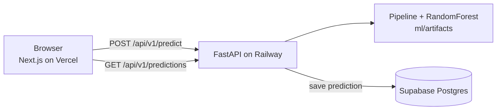

<div align="center">

# HouseIQ

**Predict California house prices from a few property details, and keep a history of every prediction.**<br>
scikit-learn model, FastAPI service, Next.js frontend and Supabase storage.


[**Model**](#model) · [**How it works**](#how-it-works) · [**Run it**](#run-it) · [**API**](#api) · [**Deploy**](#deploy)

| Training rows | R² | RMSE | MAE | Inputs |
|:---:|:---:|:---:|:---:|:---:|
| **20,640** | **0.830** | **$47,015** | **$30,807** | **9 features** |

</div>

## Model

A RandomForest regressor inside a scikit-learn preprocessing pipeline, trained on the California housing dataset (20,640 districts). Metrics are read from the committed `ml/artifacts/metadata.json` (model `v1.0`).

On average the prediction is within about **$31K** of the true median house value (MAE), with larger misses on expensive districts pulling the RMSE to $47K. Inputs: longitude, latitude, housing median age, total rooms, total bedrooms, population, households, median income and ocean proximity.

## How it works



The web app has three pages: **Predict** (a form with an animated price result), **History** (every saved prediction) and **Model** (version and metrics).

<details>
<summary><b>Example request</b></summary>

```bash
curl -s localhost:8000/api/v1/predict -H 'content-type: application/json' -d '{
  "longitude": -122.23, "latitude": 37.88, "housing_median_age": 41,
  "total_rooms": 880, "total_bedrooms": 129, "population": 322,
  "households": 126, "median_income": 8.3252, "ocean_proximity": "NEAR BAY"
}'
```

Response fields: `predicted_price`, `prediction_id`, `model_version`, `created_at`.

</details>

## Run it

```bash
git clone https://github.com/deepbendale231/House-Prediction-ML-Model-.git
cd House-Prediction-ML-Model-

# backend
python3 -m venv .venv && source .venv/bin/activate
pip install -r requirements.txt
cp .env.example .env          # set SUPABASE_URL and SUPABASE_KEY
python -m ml.train --data-path data/housing.csv --output-dir ml/artifacts   # optional: artifacts are committed
uvicorn api.main:app --reload --port 8000

# frontend (Next.js app is at the repository root)
npm install && npm run dev
```

Create the `predictions` table with `supabase_schema.sql`. The frontend reads the API address from `NEXT_PUBLIC_API_URL`.

## API

| Method | Route | Description |
|---|---|---|
| GET | /health | Health check |
| POST | /api/v1/predict | Run prediction |
| GET | /api/v1/predictions | Fetch history |
| GET | /api/v1/model | Model metadata |

---

## Deploy

### Railway

- Create a new project from this GitHub repository.
- Set `SUPABASE_URL`, `SUPABASE_KEY`, and `CORS_ORIGINS`.
- Railway builds using `Dockerfile` and deploys automatically.
- Verify backend at `/health` on your Railway domain.

### Vercel

- Import the same GitHub repository into Vercel.
- Set `NEXT_PUBLIC_API_URL` to your Railway backend URL.
- Deploy with default Next.js build settings.
- Open the Vercel URL and test prediction flow.

---

## Environment Variables

| Variable | Required | Used By | Example |
|---|---|---|---|
| SUPABASE_URL | Yes | Backend | https://xyzcompany.supabase.co |
| SUPABASE_KEY | Yes | Backend | sb_secret_xxxxxxxxxxxxx |
| CORS_ORIGINS | Yes (prod) | Backend | https://houseiq.vercel.app |
| MODEL_PATH | No | Backend | ml/artifacts/model.pkl |
| NEXT_PUBLIC_API_URL | Yes | Frontend | https://houseiq.up.railway.app |

---

## Limitations

- **No public demo linked.** Deploy configs are included (`railway.json`, `vercel.json`). The deployed frontend currently returns an error because saving to the database fails, so it is not linked until that is fixed.
- **A database outage fails the prediction.** The API saves each prediction to Supabase and returns an error if the save fails, so the model result is lost with it.
- **One classic dataset.** California district medians from 1990, so prices are far below today's market. It demonstrates the pipeline, not current valuations.
- **CI only compiles the backend.** There are no unit tests yet.

MIT License · Built by Deep Bendale
